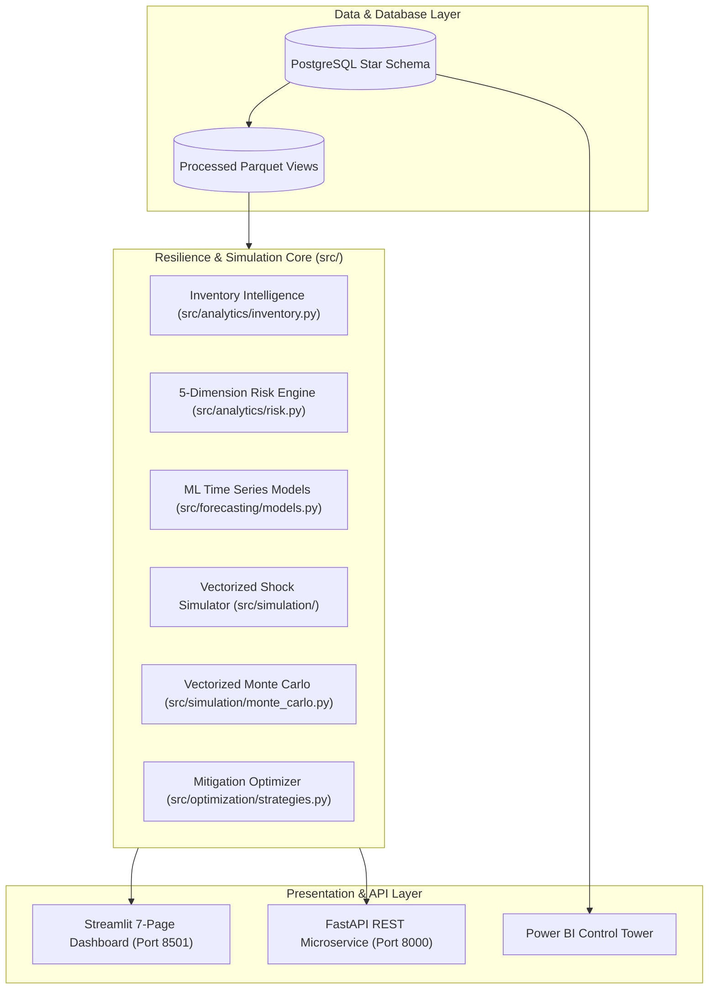

# 🛡️ Supply Chain Resilience & Shock Intelligence Platform

[](https://www.python.org/)
[](https://fastapi.tiangolo.com/)
[](https://streamlit.io/)
[](https://xgboost.readthedocs.io/)
[](https://www.postgresql.org/)
[](https://www.docker.com/)
[]()

> **An enterprise analytics & operational simulation platform answering:**  
> *"If a supplier or transit corridor is disrupted, how much revenue is at risk, when do stockouts occur, and what is the optimal mitigation action to maximize net benefit?"*

---

## 📌 Executive Summary & Architecture



---

## 🚀 Key Modules & Capabilities

### 1. 📊 Executive Overview & Control Tower (`app/pages/01_📊_Executive_Overview.py`)
- Real-time network health metrics across 20 active suppliers, 20 catalog SKUs, and 20 fulfillment hubs.
- Strategic Vulnerability Matrix mapping Supplier Risk Score against Expected Revenue Exposure.

### 2. 🏢 5-Dimension Supplier Risk Engine (`src/analytics/risk.py`)
- Multi-criteria composite risk scoring:
  - **Delay Risk (30%)**: Historical shipment delays.
  - **Reliability Risk (25%)**: On-time delivery SLA compliance.
  - **Capacity Risk (20%)**: Daily production capacity vs portfolio demands.
  - **Quality Risk (15%)**: Defect and rejection rates.
  - **Dependency Risk (10%)**: Single-source critical product vulnerability.
- Automated classification into `LOW`, `MEDIUM`, `HIGH`, and `CRITICAL` risk tiers with radar profiling.

### 3. 📦 Inventory Intelligence & Reorder Policies (`src/analytics/inventory.py`)
- Automated computation of Days of Inventory (DOI), Inventory Turnover, Safety Stock ($SS = Z \cdot \sigma \cdot \sqrt{LT}$), and Reorder Points ($ROP = \mu \cdot LT + SS$).
- Identifies critical stockout exposure windows ($DOI < 7$ days).

### 4. 📈 Machine Learning Demand Forecasting (`src/forecasting/models.py`)
- 30-day forward demand prediction comparing:
  - 7-day Moving Average baseline.
  - Holt-Winters Exponential Smoothing with weekly seasonality.
  - XGBoost Regressor utilizing lag (1, 2, 3, 7, 14 days), rolling statistics, and calendar features.
- Automated holdout validation with MAE, RMSE, and MAPE error leaderboards.

### 5. ⚡ High-Performance Disruption Simulator (`src/simulation/`)
- Interactive simulation of 5 disruption vectors:
  1. **Supplier Delivery Delay** (1–60 days).
  2. **Demand Surge** (0–100% surge).
  3. **Capacity Cut** (10–90% reduction).
  4. **Logistics & Transit Delay** (1–30 days).
  5. **Combined Multi-Vector Shock**.
- **Vectorized Monte Carlo Engine**: Executes **100,000 stochastic iterations in $< 0.1$ seconds** across all 20 suppliers, generating P5, P50, P95, and worst-case risk distributions.

### 6. 💡 Algorithmic Mitigation Optimization (`src/optimization/strategies.py`)
- Strategic decision matrix comparing 4 operational actions ranked by Net Financial Benefit ($\text{Net Benefit} = \text{Revenue Saved} - \text{Cost}$):
  1. **Do Nothing** (Baseline unmitigated loss).
  2. **Expedited Air Freight** (Recovers 90% revenue).
  3. **Alternate Supplier** (Recovers 95% revenue with one-time switching fee + unit premium).
  4. **Inter-Warehouse Inventory Transfer** (Rebalances stock across fulfillment hubs).

---

## 🛠️ Quick Start & Installation

### 1. Clone & Setup Python Virtual Environment
```bash
git clone https://github.com/sudhiradhith/SupplyChainShockSimulator.git
cd SupplyChainShockSimulator

# Create & activate Python 3.12 virtual environment
python -m venv .venv
.venv\Scripts\activate   # Windows (.venv/bin/activate on Linux/Mac)

# Install dependencies
pip install -r requirements.txt
```

### 2. Environment Configuration
```bash
copy .env.example .env
# Edit .env with your PostgreSQL credentials if connecting to live database
```

### 3. Launch Interactive Streamlit Dashboard
```bash
streamlit run app/main.py
```
> Access dashboard at **`http://localhost:8501`**

### 4. Launch FastAPI REST Service
```bash
uvicorn src.api.main:app --host 0.0.0.0 --port 8000 --reload
```
> Interactive Swagger API docs at **`http://localhost:8000/docs`**

---

## 🐳 Docker Deployment

Run the complete multi-service stack (Streamlit + FastAPI + PostgreSQL) with a single command:
```bash
docker-compose up --build
```

---

## 🧪 Automated Testing

Execute the comprehensive test suite with 31 unit and integration tests:
```bash
pytest tests/ -v
```

---

## 📁 Repository Structure

```text
SupplyChainShockSimulator/
├── data/
│   ├── raw/                # Synthetic relational CSVs (suppliers, products, inventory, demand, shipments)
│   └── processed/          # Enriched analytical Parquet files
├── src/
│   ├── analytics/          # inventory.py, risk.py
│   ├── cleaning/           # clean_data.py
│   ├── forecasting/        # models.py (MA, Holt-Winters, XGBoost)
│   ├── simulation/         # supplier_shock.py, demand_shock.py, capacity_shock.py, transport_shock.py, combined_shock.py, monte_carlo.py
│   ├── optimization/       # strategies.py
│   └── api/                # FastAPI main.py, schemas.py
├── app/
│   ├── main.py             # Streamlit landing hub
│   ├── data_loader.py      # @st.cache_data pipeline
│   ├── components/         # ui.py reusable components & CSS
│   └── pages/              # 7 modular dashboard pages (01 to 07)
├── tests/                  # 31 pytest unit & integration tests
├── docs/                   # PRD, architecture, data_dictionary, simulation_methodology, business_case
├── powerbi/                # Star schema data model specs & DAX formulas
├── Dockerfile              # Multi-stage container definition
├── docker-compose.yml      # Orchestration compose file
└── README.md               # Project documentation
```

---

## 📄 License & Transparency

- **Dataset**: Relational synthetic dataset designed for realistic supply chain analytics and stress-testing.
- **Author**: Sudhir — Portfolio Project for Data Analyst, Data Science, and AI Engineering roles.
