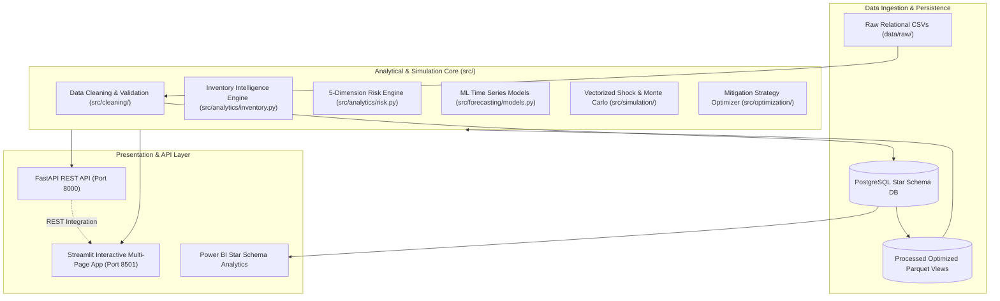

# System Architecture & Technical Specification

**Project:** Supply Chain Resilience & Shock Intelligence Platform  
**System Type:** Microservice Analytics & Interactive Simulation Platform  

---

## 1. High-Level Architecture

---

## 2. Star Schema Database Design

### Dimension Tables
- **`dim_supplier`**: `supplier_id` (PK), `supplier_name`, `country`, `capacity_per_day`, `quality_score`, `on_time_delivery_rate`, `avg_lead_time_days`.
- **`dim_product`**: `product_id` (PK), `product_name`, `category`, `unit_cost`, `price`, `criticality`.
- **`dim_warehouse`**: `warehouse_id` (PK), `warehouse_name`, `city`, `capacity`, `latitude`, `longitude`.
- **`dim_date`**: `date_id` (PK, Date), `year`, `quarter`, `month`, `month_name`, `week`, `day`, `day_name`.

### Fact Tables
- **`fact_supplier_product`**: Bridge table with composite PK (`supplier_id`, `product_id`), `contracted_lead_time_days`.
- **`fact_inventory`**: `inventory_id` (PK), `date_id` (FK), `warehouse_id` (FK), `product_id` (FK), `opening_inventory`, `received_quantity`, `demand_quantity`, `closing_inventory`.
- **`fact_demand`**: `demand_id` (PK), `date_id` (FK), `product_id` (FK), `warehouse_id` (FK), `demand_quantity`, `price`, `promotion`, `holiday`.
- **`fact_orders`**: `order_id` (PK), `date_id` (FK), `product_id` (FK), `warehouse_id` (FK), `order_quantity`, `status`.
- **`fact_shipments`**: `shipment_id` (PK), `supplier_id` (FK), `product_id` (FK), `warehouse_id` (FK), `shipment_date` (FK), `order_date`, `expected_delivery`, `actual_delivery`, `quantity`, `shipping_cost`, `delay_days`.

---

## 3. Computational Complexity & Optimizations

| Component | Standard Complexity | Optimized Vectorized Complexity | Implementation Details |
| :--- | :---: | :---: | :--- |
| **Supplier Shock Simulation** | $\mathcal{O}(P \times N_{\text{dates}})$ | $\mathcal{O}(P)$ | Precomputed product state vectors avoiding DataFrame filtering inside loops. |
| **Monte Carlo (5,000 runs)** | $\mathcal{O}(N \times P \times N_{\text{dates}})$ | $\mathcal{O}(N \times P)$ Matrix Ops | Vectorized 2D NumPy array broadcasting: $0.05$s execution for 5,000 iterations. |
| **Streamlit Data Ingestion** | Multiple disk reads | Memory cached ($\mathcal{O}(1)$) | Streamlit `@st.cache_data` in memory. |
